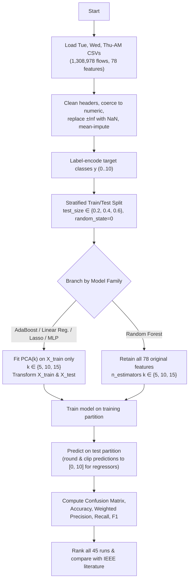

# Multi-Class Network Intrusion Detection on CIC-IDS2017: A Comparative Study of Machine Learning Models

This repository contains the official Python implementation and experimental results for the research paper:

> **A Comparative Study of Transformer-Based and Conventional Machine Learning Models for Network Intrusion Detection**  
> *Srinjay Singh, S Shivapriyaa, Chinivas Rao Lachireaddy, and Suriya Prakash J*  
> Department of Computer Science and Engineering, JAIN (Deemed-to-be-University), Bengaluru, India

---

## Overview

Modern network intrusion detection systems (IDS) must accurately separate benign traffic from diverse hostile flows across high-dimensional, strongly skewed network telemetry. This study conducts a controlled, systematic comparison of **five machine learning models** across **45 experimental configurations** on three capture days of the **CIC-IDS2017** benchmark dataset (**1,308,978 flows**, **78 flow-level features**, **11 classes**):

1. **Random Forest (`rf`)** — trained on the full 78-feature space with $k \in \{5, 10, 15\}$ trees (`criterion='entropy'`).
2. **AdaBoost (`ab`)** — trained on Principal Component Analysis (PCA) projections with $k \in \{5, 10, 15\}$ components.
3. **Multilayer Perceptron (`mpnn`)** — two hidden layers `(64, 32)` trained on PCA projections with $k \in \{5, 10, 15\}$ components.
4. **Linear Regression (`lr`)** — ordinary least squares baseline with rounded/clipped class predictions on PCA projections ($k \in \{5, 10, 15\}$).
5. **Lasso Regression (`lsr`)** — $\ell_1$-penalized linear baseline ($\alpha = 0.1$) with rounded/clipped class predictions on PCA projections ($k \in \{5, 10, 15\}$).

Each model is evaluated across three stratified train:test split ratios (**80:20**, **60:40**, and **40:60**) using **Accuracy**, **Weighted Precision**, **Weighted Recall**, and **Weighted F1-Score**.

### Key Findings

- **Random Forest is the strongest and most stable classifier by a wide margin**, achieving between **99.87% and 99.89% accuracy** across all nine of its configurations and occupying all top-5 executions in the study.
- **Peak performance of 99.89% Accuracy and 99.89% Weighted F1** is achieved by Random Forest on the **60:40 split (`test_size=0.4`) with 10 trees** (and matched with 15 trees). Even when trained on only 40% of the data (`40:60` split), accuracy remains at 99.87%–99.88%.
- **Competitive with State-of-the-Art Literature:** The best Random Forest configuration ranks second among six surveyed IEEE Xplore benchmarks on CIC-IDS2017, lying within **0.02 percentage points** of the highest reported multi-class ensemble accuracy (99.91%) while relying on a single classifier.
- **AdaBoost ranks second**, reaching **95.54% accuracy** (`94.03%` F1) on the `40:60` split and **95.47% accuracy** (`94.21%` F1) on the `60:40` split with $k = 15$ PCA components.
- **Multilayer Perceptron (MLP) peaks at 90.37% accuracy** (`88.86%` F1) on the `80:20` split with $k = 15$ PCA components, but collapses to majority-class prediction (`79.47%` accuracy, `63.16%` precision, `70.38%` F1) in 7 of 9 runs due to unstandardized high-variance flow features dominating the PCA projection.
- **Linear & Lasso Regression baselines** produce identical metrics across all 9 runs (**83.25% – 87.32% accuracy**), improving as more principal components are retained.

---

## Dataset Description

The experiments merge three capture files from the **CIC-IDS2017** intrusion detection dataset generated by `CICFlowMeter`:

| Capture File | Capture Window | Traffic & Attack Types Included |
| :--- | :--- | :--- |
| `Tuesday-WorkingHours.pcap_ISCX.csv` | Tuesday | Benign, FTP-Patator, SSH-Patator |
| `Wednesday-workingHours.pcap_ISCX.csv` | Wednesday | Benign, DoS Hulk, DoS GoldenEye, DoS slowloris, DoS Slowhttptest, Heartbleed |
| `Thursday-WorkingHours-Morning-WebAttacks.pcap_ISCX.csv` | Thursday Morning | Benign, Web Attack – Brute Force, Web Attack – XSS, Web Attack – SQL Injection |

### Class Distribution of the Merged Dataset

The concatenated table comprises **1,308,978 network flows** with **78 numerical attributes** and **1 target class column** spanning 11 classes (1 benign + 10 attack types):

| Label ID | Class Label | Records | Share (%) |
| :---: | :--- | ---: | ---: |
| `0` | BENIGN | 1,040,291 | 79.474% |
| `1` | DoS GoldenEye | 10,293 | 0.786% |
| `2` | DoS Hulk | 231,073 | 17.653% |
| `3` | DoS Slowhttptest | 5,499 | 0.420% |
| `4` | DoS slowloris | 5,796 | 0.443% |
| `5` | FTP-Patator | 7,938 | 0.606% |
| `6` | Heartbleed | 11 | 0.001% |
| `7` | SSH-Patator | 5,897 | 0.451% |
| `8` | Web Attack – Brute Force | 1,507 | 0.115% |
| `9` | Web Attack – SQL Injection | 21 | 0.002% |
| `10` | Web Attack – XSS | 652 | 0.050% |
| **Total** | **All Classes** | **1,308,978** | **100.000%** |

---

## Methodology & Workflow



### 1. Data Pre-processing
1. **Header Sanitization:** Strip leading/trailing whitespace from all CSV column names (`dataset.columns.str.strip()`).
2. **Numeric Coercion & Infinity Handling:** Convert all 78 feature columns to numeric values (`errors='coerce'`) and replace $+\infty$ and $-\infty$ with `NaN`.
3. **Mean Imputation:** Replace missing entries in each feature $j$ with its observed column mean:
   $$x_{ij} \leftarrow \bar{x}_j = \frac{1}{|O_j|} \sum_{i \in O_j} x_{ij}$$
4. **Label Encoding:** Map the 11 textual traffic labels to integers $0, \dots, 10$ via `LabelEncoder`.
5. **Stratified Splitting:** Partition the dataset into training and test subsets with `random_state=0` and `stratify=y` across three test fractions:
   - `test_size = 0.2` (**80:20** train:test split)
   - `test_size = 0.4` (**60:40** train:test split)
   - `test_size = 0.6` (**40:60** train:test split)

### 2. Dimensionality Reduction (PCA)
For **AdaBoost**, **Linear Regression**, **Lasso Regression**, and **Multilayer Perceptron**, Principal Component Analysis (PCA) is fitted strictly on the training matrix $\mathbf{X}_{\text{train}} \in \mathbb{R}^{n \times 78}$ to prevent test-set leakage, and both partitions are projected onto the top $k \in \{5, 10, 15\}$ eigenvectors:
$$\mathbf{C} = \frac{1}{n - 1}(\mathbf{X} - \mathbf{1}\boldsymbol{\mu}^\top)^\top(\mathbf{X} - \mathbf{1}\boldsymbol{\mu}^\top), \qquad \mathbf{z} = \mathbf{W}_k^\top(\mathbf{x} - \boldsymbol{\mu})$$

**Random Forest** operates directly on all 78 original features without PCA; for Random Forest, $k \in \{5, 10, 15\}$ denotes the number of decision trees (`n_estimators`).

### 3. Classifier Configurations

| Classifier | Script Prefix | Input Space | Scikit-Learn Class & Configuration |
| :--- | :---: | :--- | :--- |
| **AdaBoost** | `pca_ab_` | PCA ($k = 5, 10, 15$) | `AdaBoostClassifier()` — 50 decision-stump estimators (default) |
| **Linear Regression** | `pca_lr_` | PCA ($k = 5, 10, 15$) | `LinearRegression()` — OLS; outputs rounded & clipped to $[y_{\min}, y_{\max}]$ |
| **Lasso Regression** | `pca_lsr_` | PCA ($k = 5, 10, 15$) | `Lasso(alpha=0.1)` — $\ell_1$ penalty $\alpha = 0.1$; outputs rounded & clipped to $[y_{\min}, y_{\max}]$ |
| **Multilayer Perceptron** | `pca_mpnn_` | PCA ($k = 5, 10, 15$) | `MLPClassifier(hidden_layer_sizes=(64, 32), max_iter=500, random_state=42)` |
| **Random Forest** | `pca_rf_` | All 78 features | `RandomForestClassifier(n_estimators=k, criterion='entropy', random_state=0)` ($k = 5, 10, 15$) |

For the two continuous regression models, continuous predictions $f(\mathbf{z})$ are converted into valid discrete class indices via:
$$\hat{y} = \min\big\{\max\{\text{round}(f(\mathbf{z})),\, y_{\min}\},\, y_{\max}\big\}$$

---

## Repository Structure

The repository contains **45 standalone experiment scripts** (5 algorithms $\times$ 3 split ratios $\times$ 3 settings of $k$) and an Excel workbook summarizing all results:

```text
python_project_2026/
├── pca_ab_0_2_n5.py        # AdaBoost | test_size=0.2 (80:20) | PCA n_components=5
├── pca_ab_0_2_n10.py       # AdaBoost | test_size=0.2 (80:20) | PCA n_components=10
├── pca_ab_0_2_n15.py       # AdaBoost | test_size=0.2 (80:20) | PCA n_components=15
├── pca_ab_0_4_n5.py        # AdaBoost | test_size=0.4 (60:40) | PCA n_components=5
├── pca_ab_0_4_n10.py       # AdaBoost | test_size=0.4 (60:40) | PCA n_components=10
├── pca_ab_0_4_n15.py       # AdaBoost | test_size=0.4 (60:40) | PCA n_components=15
├── pca_ab_0_6_n5.py        # AdaBoost | test_size=0.6 (40:60) | PCA n_components=5
├── pca_ab_0_6_n10.py       # AdaBoost | test_size=0.6 (40:60) | PCA n_components=10
├── pca_ab_0_6_n15.py       # AdaBoost | test_size=0.6 (40:60) | PCA n_components=15
│
├── pca_lr_0_2_n5.py        # Linear Regression | test_size=0.2 (80:20) | PCA n_components=5
├── ... (9 scripts: pca_lr_<0_2|0_4|0_6>_n<5|10|15>.py)
│
├── pca_lsr_0_2_n5.py       # Lasso Regression (alpha=0.1) | test_size=0.2 (80:20) | PCA n_components=5
├── ... (9 scripts: pca_lsr_<0_2|0_4|0_6>_n<5|10|15>.py)
│
├── pca_mpnn_0_2_n5.py      # Multilayer Perceptron (64, 32) | test_size=0.2 (80:20) | PCA n_components=5
├── ... (9 scripts: pca_mpnn_<0_2|0_4|0_6>_n<5|10|15>.py)
│
├── pca_rf_0_2_n_5.py       # Random Forest | test_size=0.2 (80:20) | n_estimators=5 (full 78 features)
├── ... (9 scripts: pca_rf_<0_2|0_4|0_6>_n_<5|10|15>.py)
│
├── pythonproject2.xlsx     # Complete benchmark results spreadsheet (Outputs_sheets & Top-5 rankings)
└── README.md               # Project documentation
```

### File Naming Convention

- `pca_<algo>_<test_size>_n<k>.py` (or `_n_<k>.py` for Random Forest):
  - `<algo>`: `ab` (AdaBoost), `lr` (Linear Regression), `lsr` (Lasso Regression), `mpnn` (Multilayer Perceptron), `rf` (Random Forest).
  - `<test_size>`: `0_2` (`80:20` train:test), `0_4` (`60:40` train:test), `0_6` (`40:60` train:test).
  - `<k>`: `5`, `10`, or `15` (number of PCA components for `ab`/`lr`/`lsr`/`mpnn`; number of trees `n_estimators` for `rf`).

---

## Experimental Results

### Complete Results Across All 45 Executions

All figures below are reported as percentages (%) from `pythonproject2.xlsx` and Table 4 of the paper. Note that by definition of multi-class weighted recall, $\text{Recall}_{\text{w}} = \sum_c \frac{n_c}{N} \frac{TP_c}{n_c} = \frac{1}{N} \sum_c TP_c = \text{Accuracy}$.

| Classifier | Setting $k$ | 80:20 Acc (%) | 80:20 Prec (%) | 80:20 F1 (%) | 60:40 Acc (%) | 60:40 Prec (%) | 60:40 F1 (%) | 40:60 Acc (%) | 40:60 Prec (%) | 40:60 F1 (%) |
| :--- | :---: | :---: | :---: | :---: | :---: | :---: | :---: | :---: | :---: | :---: |
| **Random Forest** *(trees)* | **5** | 99.88 | 99.87 | 99.87 | 99.88 | 99.88 | 99.88 | 99.87 | 99.87 | 99.87 |
| **Random Forest** *(trees)* | **10** | 99.88 | 99.87 | 99.87 | **99.89** | **99.89** | **99.89** | 99.88 | 99.87 | 99.87 |
| **Random Forest** *(trees)* | **15** | 99.88 | 99.88 | 99.88 | **99.89** | **99.89** | **99.89** | 99.88 | 99.87 | 99.88 |
| **AdaBoost** *(PCA)* | **5** | 87.93 | 85.06 | 86.01 | 90.30 | 87.83 | 89.04 | 90.37 | 87.59 | 88.86 |
| **AdaBoost** *(PCA)* | **10** | 88.81 | 85.96 | 87.22 | 88.45 | 86.12 | 86.48 | 88.52 | 85.88 | 86.30 |
| **AdaBoost** *(PCA)* | **15** | 88.04 | 86.00 | 86.31 | 95.47 | 93.00 | 94.21 | **95.54** | **92.76** | **94.03** |
| **Multilayer Perceptron** *(PCA)* | **5** | 79.47 | 63.16 | 70.38 | 79.47 | 63.16 | 70.38 | 79.47 | 63.16 | 70.38 |
| **Multilayer Perceptron** *(PCA)* | **10** | 87.93 | 85.95 | 86.16 | 79.47 | 63.16 | 70.39 | 79.47 | 63.16 | 70.38 |
| **Multilayer Perceptron** *(PCA)* | **15** | **90.37** | **87.59** | **88.86** | 79.47 | 63.16 | 70.38 | 79.47 | 63.16 | 70.38 |
| **Linear Regression** *(PCA)* | **5** | 83.35 | 87.86 | 83.72 | 83.25 | 87.86 | 83.59 | 83.28 | 87.86 | 83.63 |
| **Linear Regression** *(PCA)* | **10** | 87.13 | 88.05 | 86.58 | 87.12 | 88.01 | 86.54 | 86.80 | 87.85 | 86.30 |
| **Linear Regression** *(PCA)* | **15** | **87.32** | **88.15** | **86.71** | 87.30 | 88.11 | 86.66 | 87.29 | 88.11 | 86.66 |
| **Lasso Regression** *(PCA)* | **5** | 83.35 | 87.86 | 83.72 | 83.25 | 87.86 | 83.59 | 83.28 | 87.86 | 83.63 |
| **Lasso Regression** *(PCA)* | **10** | 87.13 | 88.05 | 86.58 | 87.12 | 88.01 | 86.54 | 86.80 | 87.85 | 86.30 |
| **Lasso Regression** *(PCA)* | **15** | **87.32** | **88.15** | **86.71** | 87.30 | 88.11 | 86.66 | 87.29 | 88.11 | 86.66 |

### Top 5 Best-Performing Executions

| Rank | Algorithm | Train:Test Split (`test_size`) | Trees ($k$) | Accuracy (%) | Weighted F1 (%) | Script |
| :---: | :--- | :---: | :---: | :---: | :---: | :--- |
| **#1** | Random Forest | 60:40 (`0.4`) | 10 | **99.89%** | **99.89%** | `pca_rf_0_4_n_10.py` |
| **#2** | Random Forest | 60:40 (`0.4`) | 15 | **99.89%** | **99.89%** | `pca_rf_0_4_n_15.py` |
| **#3** | Random Forest | 60:40 (`0.4`) | 5 | **99.88%** | **99.88%** | `pca_rf_0_4_n_5.py` |
| **#4** | Random Forest | 80:20 (`0.2`) | 15 | **99.88%** | **99.88%** | `pca_rf_0_2_n_15.py` |
| **#5** | Random Forest | 40:60 (`0.6`) | 15 | **99.88%** | **99.88%** | `pca_rf_0_6_n_15.py` |

### Comparison with Surveyed IEEE Literature on CIC-IDS2017

| Rank | Study | Venue & Year | Methodology | Reported Accuracy |
| :---: | :--- | :--- | :--- | :---: |
| 1 | Roponena & Poļaka [5] | IEEE ITMS, 2022 | Classifier ensemble selection with feature selection (multi-class) | 99.91% |
| **2** | **Proposed Work (Random Forest)** | **2026** | **Single Random Forest (10 trees, entropy criterion, 60:40 split)** | **99.89%** |
| 3 | Yang, Moubayed & Shami (MTH-IDS) [6] | IEEE IoT Journal, 2022 | Multi-tiered signature + anomaly hybrid with tree ensembles | 99.88% |
| 4 | Kurniabudi et al. [4] | IEEE Access, 2020 | Information Gain feature selection (52 features) with J48 | 99.87% |
| 5 | Yang et al. [3] | IEEE GLOBECOM, 2019 | Stacked DT, RF, ET, and XGBoost with tree-importance selection | 99.86% |
| 6 | Abdulhammed et al. [2] | IEEE ISNCC, 2019 | PCA (81 to 10 components) with minority class balancing | 99.60% |

---

## Discussion & Limitations Noted in the Study

1. **Lack of Feature Standardization Before PCA:** Flow attributes in CIC-IDS2017 span vastly different numerical scales (e.g., byte counts vs. flag counts). Because features were not standardized (zero mean, unit variance) prior to PCA, high-variance columns dominate the leading eigenvectors. This explains why the Multilayer Perceptron failed to converge in 7 of 9 configurations (predicting the 79.47% majority `BENIGN` class, yielding $P_{\text{w}} = a^2 \approx 63.16\%$ and $F1_{\text{w}} = \frac{2a^2}{1+a} \approx 70.38\%$) and why the $\ell_1$ penalty ($\alpha = 0.1$) in Lasso Regression had negligible difference compared to ordinary least squares Linear Regression.
2. **Pre-Split Mean Imputation:** Missing and infinite values were imputed with column means on the merged dataset prior to train/test splitting; fitting the imputer exclusively on the training split is recommended for strict leakage prevention.
3. **Dataset Coverage & Class Imbalance:** The experiments evaluate three of the eight CIC-IDS2017 capture files and preserve the natural class skew (79.47% benign, only 11 Heartbleed flows and 21 SQL Injection flows). Per-class metrics and rebalancing techniques (e.g., SMOTE or class weights) are important before production deployment.
4. **Regression Baselines on Nominal Classes:** Rounding continuous regression outputs treats nominal label codes ($0, \dots, 10$) as ordinal values and is included strictly as a linear baseline.

---

## Getting Started & Reproducing Results

### 1. Prerequisites

Ensure you have **Python 3.8+** installed along with the required scientific libraries:

```bash
pip install numpy pandas scikit-learn openpyxl
```

### 2. Download the CIC-IDS2017 CSV Files

Download the **MachineLearningCSV** archive from the official [UNB CIC-IDS2017 Dataset Portal](https://www.unb.ca/cic/datasets/ids-2017.html) and place the following three CSV files directly in the root directory of this repository:

- `Tuesday-WorkingHours.pcap_ISCX.csv`
- `Wednesday-workingHours.pcap_ISCX.csv`
- `Thursday-WorkingHours-Morning-WebAttacks.pcap_ISCX.csv`

### 3. Run an Experiment

Execute any of the 45 scripts directly with Python. For example, to run the top-performing configuration (**Random Forest, 60:40 split, 10 trees**):

```bash
python pca_rf_0_4_n_10.py
```

Or run the best PCA-based **AdaBoost** configuration (**40:60 split, 15 PCA components**):

```bash
python pca_ab_0_6_n15.py
```

Each script outputs:
- The full $11 \times 11$ **Confusion Matrix**
- Overall **Accuracy**, **Weighted Precision**, **Weighted Recall**, and **Weighted F1 Score**
- Per-class **Classification Report** (`precision`, `recall`, `f1-score`, `support`)

---

## Citation

If you use this code or data in your research, please cite:

```bibtex
@inproceedings{singh2026comparative,
  title     = {A Comparative Study of Transformer-Based and Conventional Machine Learning Models for Network Intrusion Detection},
  author    = {Singh, Srinjay and Shivapriyaa, S and Lachireaddy, Chinivas Rao and Suriya Prakash, J},
  booktitle = {Department of Computer Science and Engineering, JAIN (Deemed-to-be-University)},
  year      = {2026},
  address   = {Bengaluru, India},
  url       = {https://github.com/srinjays/python_project_2026}
}
```

